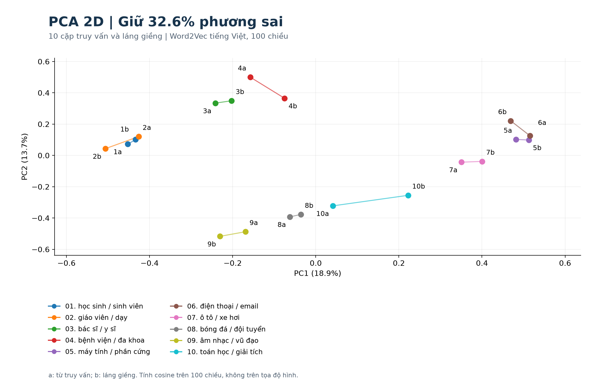

# Bài thực hành Word Embedding tiếng Việt

## Nội dung

- **Bài 1:** Huấn luyện mới Word2Vec Skip-gram với negative sampling; mỗi từ có vector 100 chiều.
- **Bài 2:** Tìm 10 cặp bằng cosine, giảm chiều bằng PCA 2D, PCA 3D và t-SNE 2D.
- [Báo cáo lời giải PDF](Bao_cao_Word_Embedding.pdf).
- [Notebook có lời giải và kết quả đã thực thi](Bai_tap_Word_Embedding_VI.ipynb).
- [Chương trình Python đầy đủ](word_embedding_vi.py).

## Kết quả đã chạy

- Ngữ liệu: 2.000 bài Wikipedia tiếng Việt, bản `20231101.vi`; 1.999 bài còn câu hợp lệ.
- Corpus sau xử lý: 3.805.712 token; từ vựng: 23.788 từ.
- Word2Vec: Skip-gram, 100 chiều, 15 epochs, seed 42.
- PCA trên 20 từ của 10 cặp: 2D giữ 32,56%; 3D giữ 46,01% phương sai.
- Notebook đã chạy đủ 15 ô mã; kiểm tra cosine, kích thước và lưu/nạp mô hình đều đạt.



## Chạy bằng Python

Clone repository rồi mở terminal trong thư mục dự án. Môi trường đã kiểm tra: Python 3.12.

```bash
git clone https://github.com/phatcaoduc2910/NLP-Word-Embedding.git
cd NLP-Word-Embedding
```

```bash
python -m pip install -r requirements.txt
python word_embedding_vi.py --stage analyze
```

Lệnh trên nạp mô hình đã huấn luyện, tính lại 10 cặp và xuất hình. Không cần tải dữ liệu.

Huấn luyện lại từ corpus đã tách từ:

```bash
python word_embedding_vi.py --stage train
python word_embedding_vi.py --stage analyze
```

Chạy toàn bộ từ đầu khi chưa có dữ liệu:

```bash
python word_embedding_vi.py --stage all
```

Chương trình tự tải dữ liệu công khai khi thiếu. Cần Internet cho bước tải và cài thư viện. `workers=1`, `seed=42` và hàm băm CRC32 giúp ổn định kết quả. Khác phiên bản thư viện hoặc nền tảng vẫn có thể gây sai khác số học nhỏ.

## Chạy notebook trên Jupyter hoặc Colab

Notebook chứa mã độc lập, không cần import chương trình `.py`. Chạy lần lượt từ trên xuống. Ô thiết lập ghi rõ thư mục dữ liệu và tùy chọn huấn luyện lại. Với Colab, clone repo vào `/content/NLP-Word-Embedding` hoặc giải nén gói vào `/content/word_embedding_vi` để dùng ngay mô hình và dữ liệu đã cung cấp. Nếu chưa có các thư mục này, notebook tự tải dữ liệu và huấn luyện từ đầu. Notebook có thể đọc trực tiếp các bảng và hình đã lưu mà không chạy lại.

## Các tệp kết quả

| Tệp | Nội dung |
|---|---|
| `models/word2vec_vi.model` | Mô hình Word2Vec đầy đủ, có thể huấn luyện tiếp |
| `models/word_vectors_vi.kv` | Vector từ và từ vựng, dùng truy vấn |
| `data/wiki_vi_2000.jsonl.gz` | 2.000 bài nguồn, kèm tiêu đề, URL và chỉ số hàng |
| `data/corpus_tokenized.txt` | Corpus tiếng Việt đã tách từ, mỗi dòng là một câu gần đúng |
| `data/*metadata.json` | Thống kê, nguồn dữ liệu và SHA-256 |
| `training_metadata.json` | Tham số, số lượng từ, thời gian và phiên bản |
| `results/10_cap_tuong_dong.csv` | 10 cặp, cosine 100D, hạng láng giềng và tần suất |
| `results/toa_do_2d_3d.csv` | Tọa độ PCA 2D/3D và t-SNE 2D |
| `results/vectors_and_projection.npz` | Vector gốc, ma trận chiếu PCA và tọa độ |
| `figures/*.png` | Ba biểu đồ |

## Cách hiểu kết quả

Mười từ truy vấn được chọn trước khi huấn luyện. Mỗi từ ghép với láng giềng gần nhất theo cosine trong toàn bộ từ vựng, bỏ cặp đảo chiều nếu trùng. Đây là 10 cặp minh họa theo truy vấn, **không phải 10 cặp cao nhất của toàn bộ từ vựng**. Cosine cao có thể biểu thị gần nghĩa hoặc liên quan ngữ cảnh; không tự động chứng minh đồng nghĩa. Cosine không phải xác suất hay độ chính xác.

PCA và t-SNE chỉ fit trên các từ thuộc 10 cặp đã tìm. Chuẩn hóa L2 vector trước khi giảm chiều. Tỷ lệ phương sai PCA chỉ áp dụng cho tập từ này. Hình chiếu có mất thông tin; không dùng khoảng cách trên hình để thay thế cosine 100 chiều. Không có tập chuẩn gán nhãn nên bài làm chưa đo chất lượng ngữ nghĩa trên dữ liệu độc lập.

## Nguồn và ghi công

1. Tài liệu người dùng: **3. Semantics-WordEmbedding.pdf**, TS. Vương Thị Hải Yến, Trường Đại học Công nghệ - ĐHQG Hà Nội. Các trang sử dụng: 7, 21, 26, 38, 49-50, 59-61 và 69. Tài liệu dùng làm cơ sở lý thuyết, không dùng làm corpus huấn luyện.
2. [Wikimedia Wikipedia trên Hugging Face](https://huggingface.co/datasets/wikimedia/wikipedia), cấu hình `20231101.vi`, split `train`, hàng 0-1999. Đây là mẫu thuận tiện theo thứ tự dữ liệu, không phải mẫu ngẫu nhiên đại diện toàn bộ tiếng Việt.
3. Ngữ liệu Wikipedia do cộng đồng Wikipedia đóng góp; thẻ dữ liệu ghi CC BY-SA 3.0 / GFDL. URL từng bài được giữ trong JSONL để ghi công và truy cập lịch sử tác giả. Bản corpus đã xử lý giữ ghi công và điều kiện chia sẻ tương ứng: [CC BY-SA 3.0](https://creativecommons.org/licenses/by-sa/3.0/), [GFDL](https://www.gnu.org/licenses/fdl-1.3.html). Thay đổi: chuẩn hóa Unicode, tách câu/từ, chuyển chữ thường, bỏ URL, số, dấu câu, câu ngắn và văn bản trùng.
4. [Gensim Word2Vec](https://radimrehurek.com/gensim/models/word2vec.html).
5. [Pyvi](https://github.com/trungtv/pyvi).
6. [scikit-learn PCA](https://scikit-learn.org/stable/modules/generated/sklearn.decomposition.PCA.html) và [t-SNE](https://scikit-learn.org/stable/modules/generated/sklearn.manifold.TSNE.html).
